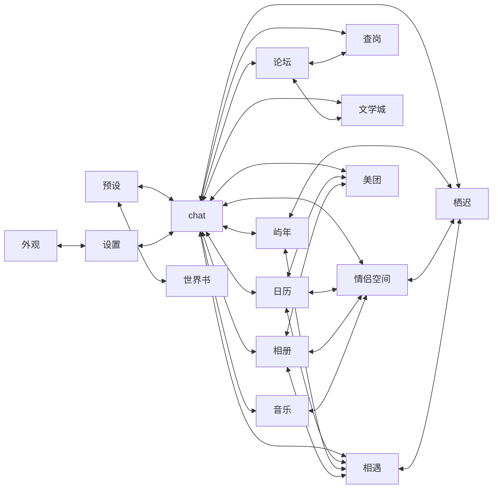

# 岛屿机

> 一台装在手机里的"小手机"。里面有 16 个 App,主玩法是和 AI 角色(char)过日子。
> 仓库状态:文档阶段(还没有代码)。当前版本:v0.0.1

---

## 一、这是什么(大白话)

岛屿机是一个纯原生安卓 App。打开它,你看到的是一台完整的"手机":有锁屏、桌面、16 个小 App。

核心玩法是角色扮演:

- 里面的 char 要像真人:有自己的生活、朋友,每年会成长。
- char 不围着 user(你)转,不会突然冒出"AI 腔",不会被模型"上身"。
- char 有自己的"内在状态"(想不想你、累不累、对什么好奇),会自己行动,不只是等你说话。

## 二、硬性要求

| 要求 | 大白话 |
|---|---|
| 纯原生安卓 | 不是网页套壳,不靠系统网页内核 |
| 流畅 | 长聊天滑动、切换对话都要丝滑,数据再多也不卡、不延迟 |
| 保活 | char 回复的时候你切页面、切后台,回来照样能收到回复 |
| 存储 | 用系统自带数据库,像微信、QQ 一样长期存,尽量不丢 |
| 网络 | 流式输出(一个字一个字蹦出来)用原生网络自己做,保证稳定 |
| 能力 | 直接调系统能力;预留快捷键、本地模型、精细缓存、离线 |
| 外观 | 完全复刻苹果原生手机的视觉和交互,但不要"液态玻璃"效果 |
| 升级 | 新包用同一把签名,可直接覆盖安装旧包,数据保留 |

## 三、16 个 App

| # | App | 一句话 |
|---|---|---|
| 1 | chat | 主功能。和 char 线上聊天,像微信/QQ,含钱包、朋友圈、群聊 |
| 2 | 外观 | 装修桌面:图标、壁纸、字体、emoji 字体 |
| 3 | 屿年 | 记录 char 每一年的成长,也能补记和你认识之前的过去 |
| 4 | 相册 | 每个 char 一本相册,存截图和 char 拍的照片,含私密相册 |
| 5 | 日历 | char 每天的日程,让 char 有真实的日常 |
| 6 | 设置 | API、登录、通知、备份、更新 |
| 7 | 世界书 | 给 char 背景和"活人感"的提示词 |
| 8 | 音乐 | 接网易云,也能放本地音乐和歌词 |
| 9 | 相遇 | char 和你线下见面,酒馆式长篇剧情;也能"穿越"补全过去 |
| 10 | 查岗 | 关联账号,互相看对方收到的消息、登录对方账号查手机 |
| 11 | 论坛 | 像微博/X,char 自己建号发帖,还有 NPC 发帖评论 |
| 12 | 文学城 | 生成同人文/小说,你也能注册发文 |
| 13 | 情侣空间 | 你和 char 互相邀请开通的二人小天地 |
| 14 | 预设 | 五星核心。管所有 App 的提示词和 char 的"内在驱动系统" |
| 15 | 美团 | 点外卖、团购,可用真实定位虚拟下单 |
| 16 | 栖迟 | char 的梦境 App,像文字游戏,可选选项走不同结局 |

## 四、主要页面

**启动与桌面**:加载动画(雨滴落下的文艺开场)→ 锁屏 → 主屏幕(图标可拖动、可放文件夹)→ 内置桌面组件(每个组件都有类名,可自定义和导入)

**chat 里的页面**:消息、联系人、朋友圈、我、私聊、私聊设置(私聊各部分有类名,可做 QQ 主题式美化)

**设置里的页面**:API 设置、系统设置、登录系统(仅开发者可见)

**其他 App**:各自的首页、详情页、设置页(详见 `docs/开发计划.md`)

## 五、打通关系图

所有线都是**双向互通**。每一对具体互通什么,见 `docs/打通关系表.md`。

预设、世界书、设置、外观是"底座",对所有 App 都生效,表格里单独写。

## 六、文档地图

| 文件 | 干什么用 |
|---|---|
| `README.md` | 就是你正在看的这份,讲项目是什么 |
| `CLAUDE.md` | 长期说明书:技术栈、目录、代码规则。每次开工自动读 |
| `docs/开工必读.md` | 总入口,告诉每次开工该读哪几份 |
| `docs/开发计划.md` | 小任务清单,按顺序一次做一个 |
| `docs/打通关系表.md` | 16 个 App 两两互通的具体内容 |
| `docs/rules/记忆系统.md` | 记忆怎么存、怎么取 |
| `docs/rules/世界书管线.md` | 世界书怎么注入 |
| `docs/rules/用户空间.md` | 你的资料、账号、你能创建的内容 |
| `docs/rules/界面与主题.md` | 视觉、日夜间、返回手势、弹窗 |
| `docs/rules/数据存储.md` | 数据库、备份、覆盖安装 |
| `docs/rules/代码结构.md` | 文件怎么分、怎么改不出事 |
| `docs/rules/预设与提示词.md` | 提示词模块、共用读取流程、内在驱动系统 |
| `.github/workflows/build.yml` | 自动打包签名的脚本 |

## 七、打包与安装

代码推送到 `main` 后,GitHub Actions 自动打包并签名。需要仓库里已配好 4 个密钥:
`KEYSTORE_BASE64`、`KEYSTORE_PASSWORD`、`KEY_ALIAS`、`KEY_PASSWORD`。

新包和旧包用同一把签名、同一个包名、版本号更大,就能直接覆盖安装,数据不丢。
打好的 APK 在 Actions 运行页的 Artifacts 里,也会发布到 Releases。

## 八、当前进度

- [x] 文档阶段(本轮)
- [ ] 下一步:整理苹果官方设计依据,再设计加载界面、锁屏、主屏幕和全部界面
- [ ] 之后:按 `docs/开发计划.md` 一次做一个任务
